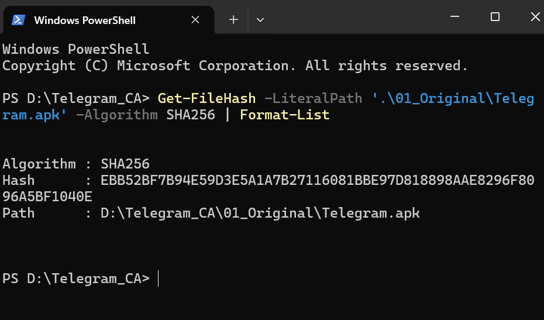
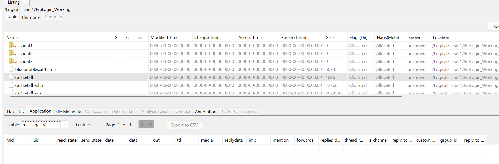
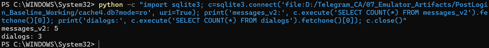
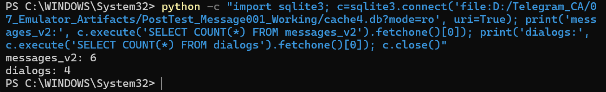
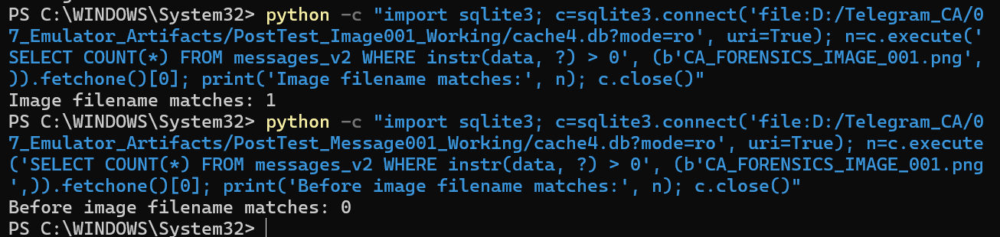
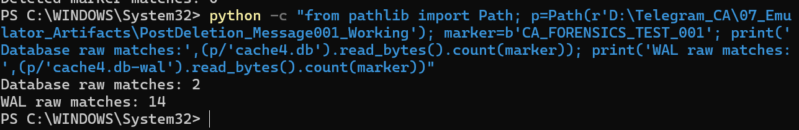

# Telegram Android Forensics — Findings and Analysis

## 1. Investigation Summary

This document summarises observations from a controlled
forensic investigation of the Telegram Android application.

The investigation involved application examination,
Android log collection, dynamic testing, forensic tools,
and evidence integrity verification.

## 2. Environment and Connectivity

An Android Studio emulator was used as the test environment.

ADB was used to communicate with the emulator and
collect investigation data.

## 3. Android Log Collection

Application and system logs were collected using
Android Logcat.

A pre-login log file was saved and its SHA-256 hash
was calculated to support evidence integrity verification.

## 4. Application Examination

JADX was used to examine the Android application package.

The investigation included reviewing available application
structures and documenting technical observations.

## 5. Dynamic Testing

Controlled application testing was performed using
the Android emulator.

Application states and observable changes were recorded
during testing.

These observations were documented for comparison
and further forensic examination.

## 6. Forensic Tools

FTK Imager was used during the investigation process.

An Autopsy case was created to organise and examine
available forensic material.

The creation of a forensic case does not, by itself,
demonstrate successful recovery of protected user data.

## 7. Evidence Integrity

SHA-256 hashing was used to support verification
of collected investigation files.

Original evidence files and sensitive investigation
data are not included in this repository.

## 8. Limitations

The investigation was limited to the available emulator
environment and accessible evidence.

The work does not establish complete recovery of
Telegram's protected application data.

## 9. Key Learning Outcomes

- Android forensic investigation
- Log collection and examination
- Controlled application testing
- Evidence integrity verification
- Forensic tool usage
- Technical documentation

## 10. Supporting Evidence

Selected sanitised screenshots and evidence references
will be added after verification and publication review.

## 11. Verified Forensic Evidence

### Evidence 1 — SHA-256 Verification

SHA-256 was calculated for the original Telegram APK
to document its cryptographic hash.

### Evidence 2 — Pre-Login SQLite Examination

Autopsy displayed the messages_v2 table with
0 entries in the examined pre-login database.

### Evidence 3 — Post-Login Database Analysis

SQLite queries returned:
- messages_v2: 5 records
- dialogs: 3 records

### Evidence 4 — Controlled Message Testing

After controlled message testing, SQLite queries returned:
- messages_v2: 6 records
- dialogs: 4 records

These counts show differences between the examined
database states. They do not independently establish
the cause of every change.

### Evidence 5 — Image Artefact Examination

A search for the test image filename returned:
- Before image testing: 0 matches
- After image testing: 1 match

This supports the observation that the filename
was present in the examined post-test database.

## 12. Evidence Interpretation

The screenshots document forensic examination
procedures and observable database differences.

Record counts and filename matches alone do not
prove complete message recovery or establish
that deleted data can be reconstructed.

## 13. Post-Deletion Artefact Analysis

### Objective

To investigate whether a controlled test marker
remained detectable in Telegram database-related
files after message deletion testing.

### Examination

A Python script searched for the test marker
in the raw bytes of two collected files:

- cache4.db
- cache4.db-wal

### Observed Results

| File | Raw Marker Matches |
|---|---:|
| cache4.db | 2 |
| cache4.db-wal | 14 |

### Interpretation

The test marker was detected in both the SQLite
database and write-ahead log after deletion testing.

These results show residual byte-level matches
in the examined files.

However, these matches do not prove that
the deleted message was fully recovered or
that a complete message record was reconstructed.

### Forensic Significance

This observation highlights why both SQLite
database files and WAL files may be relevant
during mobile forensic investigations.
