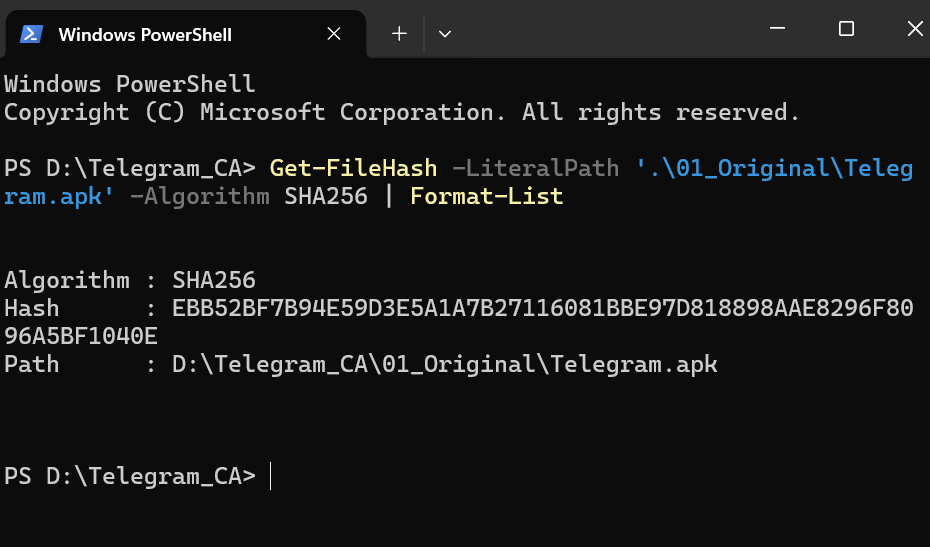
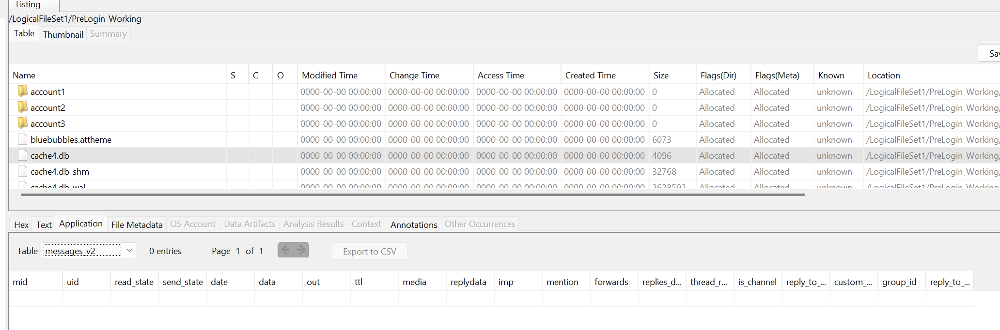
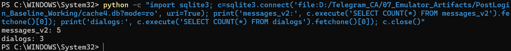
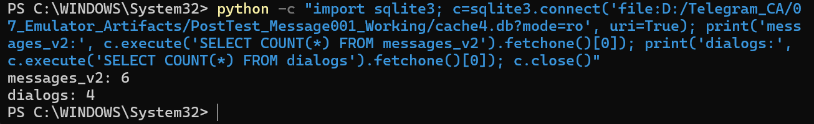
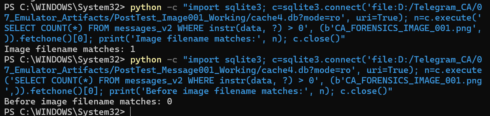
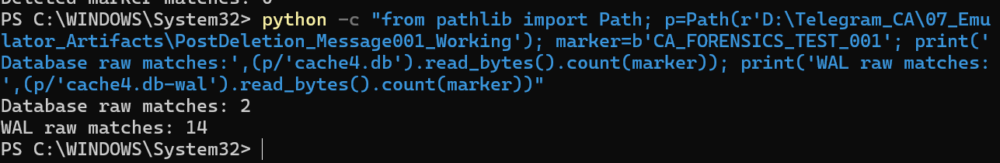

# 📸 Telegram Android Forensics — Evidence Gallery

This gallery presents selected evidence from a controlled
forensic investigation of the Telegram Android application.

## Evidence 1 — SHA-256 Verification

SHA-256 hash calculation for the original Telegram APK.

---

## Evidence 2 — Pre-Login Database Examination

Autopsy examination of the messages_v2 table
showing 0 entries before login.

---

## Evidence 3 — Post-Login SQLite Analysis

SQLite query results:
- messages_v2: 5 records
- dialogs: 3 records

---

## Evidence 4 — Controlled Message Testing

SQLite query results after testing:
- messages_v2: 6 records
- dialogs: 4 records

---

## Evidence 5 — Image Artefact Verification

Comparison of image filename matches:
- Before testing: 0 matches
- After testing: 1 match

---

## Evidence 6 — Post-Deletion Artefact Analysis

Raw test-marker matches detected after deletion:
- cache4.db: 2 matches
- cache4.db-wal: 14 matches

These byte-level matches do not prove complete
recovery of a deleted message.

---

## Privacy and Evidence Handling

All evidence was collected in a controlled
laboratory environment.

Screenshots are retained in a private repository
pending publication and confidentiality review.
